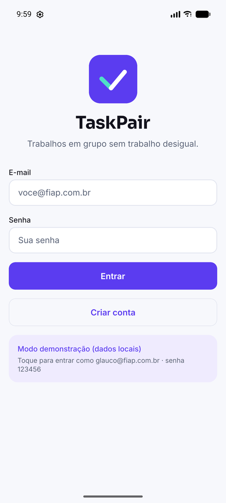
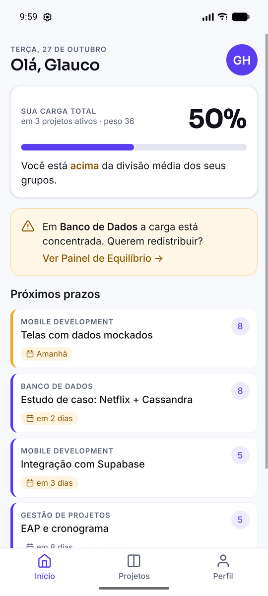
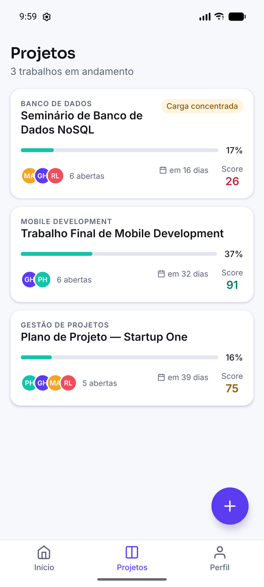
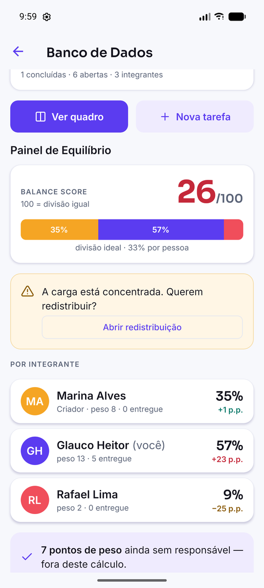
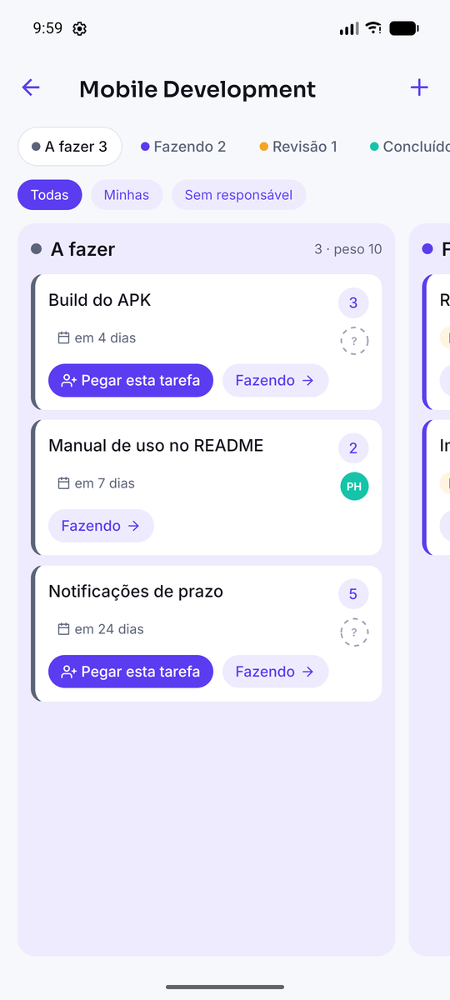
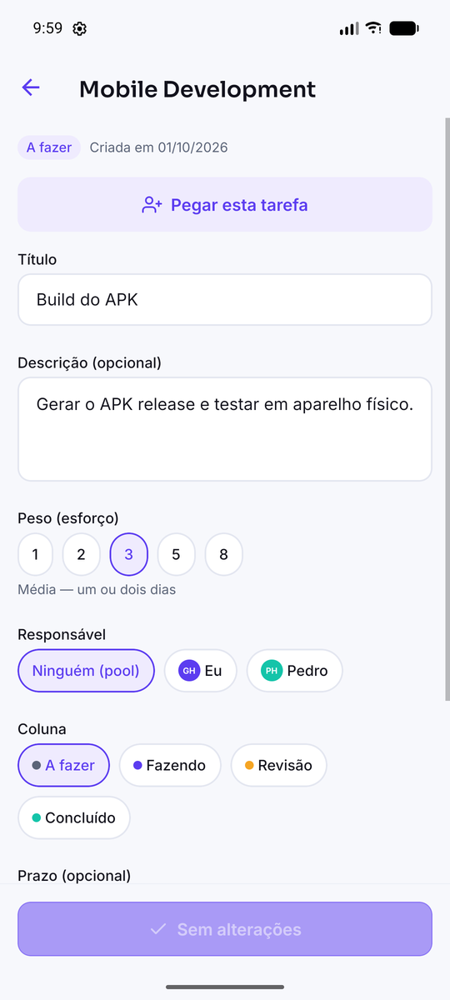
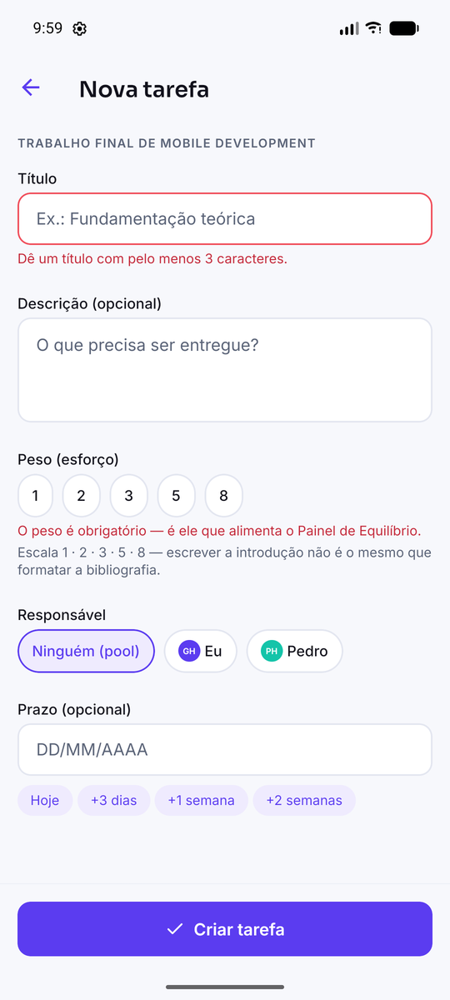
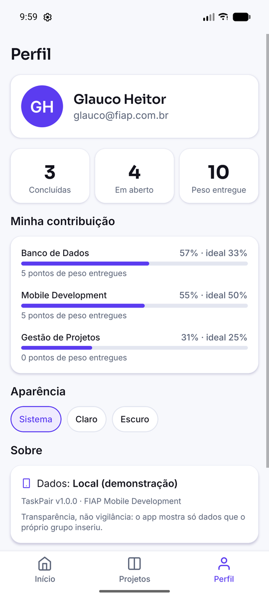
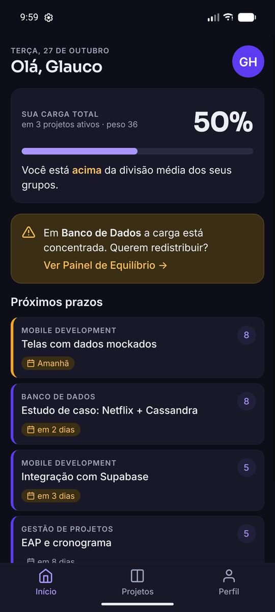

<div align="center">


# TaskPair

**Trabalhos em grupo sem trabalho desigual.**

Aplicativo mobile em React Native que torna visível *quem está fazendo quanto* em um trabalho acadêmico — cedo o bastante para o grupo redistribuir sozinho.


**[⬇️ Baixar o APK](https://github.com/glaucoheitor21/taskpair/releases/latest)** · [Manual de uso](docs/08-manual-de-uso.md) · [Telas e fluxos](docs/06-telas-e-fluxos.md)

</div>

---

## Integrantes

| Nome | RM | Frente principal |
|---|---|---|
| Glauco Heitor Gonçalves e Silva | 555978 | Arquitetura front-end · Banco de dados |
| Pedro Henrique Junqueira | 556278 | UX/UI e identidade visual · Integração e build |

**Disciplina:** Mobile Development · **Entregas:** Checkpoints 4, 5 e 6

---

## O problema

Todo estudante já carregou um trabalho em grupo sozinho. Existem dezenas de apps de tarefas, e nenhum deles resolve isso — porque todos mostram **o que falta fazer** e nenhum mostra **quem está fazendo quanto**.

## A solução

No TaskPair **toda tarefa tem um peso** (1 · 2 · 3 · 5 · 8). Escrever a fundamentação teórica não é o mesmo esforço que formatar as referências, e um app que conta cartões finge que é.

Com peso, o app responde à pergunta que os outros não respondem — *"quanto do trabalho é meu?"* — no **Painel de Equilíbrio**: uma barra com a fatia de cada integrante e um **Balance Score** de 0 a 100. Quando alguém passa de 15 pontos percentuais acima da divisão ideal, o app sugere *"A carga está concentrada. Querem redistribuir?"* — nunca *"fulano está fazendo pouco"*.

O cálculo é público e testado: [`src/utils/workload.ts`](src/utils/workload.ts) · [`__tests__/workload.test.ts`](__tests__/workload.test.ts).

> **Transparência, não vigilância.** O app mostra só dados que o próprio grupo inseriu. Nenhuma redistribuição é automática — o TaskPair aponta, a conversa é humana.

---

## O app

Capturas do APK release rodando no emulador **Pixel 7** do Android Studio.

| Entrar | Início | Projetos |
|:--:|:--:|:--:|
|  |  |  |
| E-mail e senha (Supabase Auth). No modo local, atalho de demonstração. | Minha carga, alerta de concentração e próximos prazos. | Progresso por peso, prazo e Balance Score de cada projeto. |

| Painel de Equilíbrio | Quadro Kanban | Detalhe da tarefa |
|:--:|:--:|:--:|
|  |  |  |
| Score, barra por integrante, desvio em p.p. e o convite a redistribuir. | Uma coluna por vez; "Pegar esta tarefa" e "→ próxima coluna". | Editar peso, responsável, coluna e prazo. |

| Nova tarefa | Perfil | Modo escuro |
|:--:|:--:|:--:|
|  |  |  |
| Peso obrigatório com explicação de cada nível. | Contribuição por projeto vs. divisão ideal. | Tokens de tema claro/escuro do CP4. |

### Funcionalidades

- **Conta:** cadastro, login, sessão persistida, sair.
- **Projetos:** criar, convidar integrante por e-mail, remover integrante (tarefas voltam ao pool), arquivar, excluir.
- **Tarefas:** criar com peso obrigatório, editar, atribuir, deixar no pool, "pegar", mover entre as colunas *A fazer → Fazendo → Revisão → Concluído*, excluir.
- **Painel de Equilíbrio:** Balance Score, barra empilhada, carga e desvio por integrante, peso no pool, alerta de concentração (no projeto e na Início).
- **Início:** minha carga total, alertas, próximos prazos com cor de urgência, contador do pool.
- **Perfil:** estatísticas, contribuição por projeto, tema sistema/claro/escuro.
- **Qualidade:** estados de carregando, vazio e erro com "tentar de novo"; validação de formulários; acessibilidade (rótulos, papéis, alvos ≥ 44 dp, contraste WCAG AA).

---

## Como rodar

**Pré-requisitos:** Node.js 20+ e npm. Para celular: app **Expo Go** (SDK 58). Para emulador: Android Studio com um AVD.

```bash
git clone https://github.com/glaucoheitor21/taskpair.git
cd taskpair
npm install
npx expo start
```

- **Celular:** leia o QR Code com o Expo Go.
- **Emulador Android:** com o emulador aberto, aperte `a` no terminal do Expo.
- **Navegador:** aperte `w`.

### Dados: Supabase ou modo local

| Modo | Quando | Login |
|---|---|---|
| **Supabase** | Existe um `.env` com `EXPO_PUBLIC_SUPABASE_URL` e `EXPO_PUBLIC_SUPABASE_ANON_KEY` | Crie sua conta no próprio app |
| **Local** | Sem `.env` | Toque em *Modo demonstração* ou use `glauco@fiap.com.br` / `123456` |

O modo local copia os dados de [`src/mocks/`](src/mocks) para o aparelho e salva tudo que você alterar. Para configurar o banco, siga [`docs/09-supabase.md`](docs/09-supabase.md) (≈5 minutos: criar projeto, rodar [`supabase/schema.sql`](supabase/schema.sql), colar URL e chave no `.env`).

### Testes

```bash
npm test             # 35 testes Jest: regra de equilíbrio, serviços, componentes
npm run typecheck    # TypeScript strict
```

Detalhes e roteiro de testes manuais em [`docs/07-testes.md`](docs/07-testes.md).

### Gerar o APK

**Local (Windows, Git Bash)** — requer Android SDK, o JDK do Android Studio e *CMake 3.31.6* instalado pelo SDK Manager:

```bash
npm run build:apk:local
# → android/app/build/outputs/apk/release/app-release.apk
```

**Na nuvem (EAS Build)** — requer conta Expo:

```bash
npx eas-cli login
npm run build:apk
```

---

## Documentação

| Documento | Conteúdo |
|---|---|
| 📄 [Escopo](docs/01-escopo.md) | Problema, público-alvo, personas, proposta de valor, requisitos, riscos |
| 🎨 [Marca e identidade visual](docs/02-marca.md) | Nome, símbolo, paleta com contraste verificado, tipografia, tom de voz |
| 💡 [Pitch e modelo de negócio](docs/03-pitch-modelo-de-negocio.md) | Monetização, concorrência, TAM/SAM/SOM, aquisição |
| 🏗️ [Arquitetura e decisões técnicas](docs/04-arquitetura.md) | Stack, bibliotecas, estrutura de pastas, camada de dados, modelo |
| 🗺️ [Roadmap](docs/05-roadmap.md) | O que foi entregue em cada checkpoint e o que fica para depois |
| 🧭 [Telas e fluxos](docs/06-telas-e-fluxos.md) | Mapa de navegação, descrição de cada tela, fluxos principais |
| 🧪 [Testes](docs/07-testes.md) | Jest (35 testes) e roteiro de testes manuais |
| 📱 [Manual de uso](docs/08-manual-de-uso.md) | Como instalar e usar o app |
| 🗄️ [Supabase](docs/09-supabase.md) | Modelo do banco, políticas RLS, configuração |
| 🎤 [Roteiro de apresentação](docs/10-roteiro-apresentacao.md) | Demo de 5 minutos para a banca |

---

## Estrutura do projeto

```
taskpair/
├── App.tsx            Fontes, splash, provedores e navegação
├── src/
│   ├── theme/         Tokens de cor (claro/escuro), tipografia, espaçamento
│   ├── types/         Modelo de domínio em TypeScript
│   ├── utils/         Cálculo de equilíbrio, datas, validações (regras puras)
│   ├── mocks/         Dados de demonstração (modo local)
│   ├── services/      Única fronteira com dados: Supabase ou local
│   ├── contexts/      AuthContext, ProjectContext
│   ├── hooks/         useAuth, useProjects, useTasks, useBalance
│   ├── navigation/    Root (stack), Auth (stack), App (tabs) — rotas tipadas
│   ├── components/    common · layout · project · task
│   └── screens/       auth · home · projects · tasks · profile
├── __tests__/         Testes Jest
├── supabase/          Esquema SQL do banco + RLS
├── scripts/           Build local do APK
├── docs/              Documentação
└── brand/             Logo em SVG e PNG
```

A regra que sustenta a estrutura desde o CP4: **nenhuma tela faz `fetch`, importa de `mocks/` ou fala com o Supabase.** Tudo passa por `services/`, e por isso trocar dados mockados por banco real não exigiu reescrever nenhuma tela.

---

## Stack

| Camada | Tecnologia |
|---|---|
| Runtime | React Native 0.88 · Expo SDK 58 |
| Linguagem | TypeScript (`strict`) |
| Navegação | React Navigation 7 — native-stack + bottom-tabs |
| Estado | Context API + hooks |
| Banco e autenticação | Supabase (PostgreSQL, Auth, Row Level Security) |
| Persistência local | AsyncStorage |
| Fontes e ícones | @expo-google-fonts (Sora, Inter) · Feather |
| Testes | Jest · jest-expo · Testing Library |
| Build | Gradle local / EAS Build → APK |

---

## Roadmap

| Checkpoint | Etapa | Estado |
|---|---|---|
| **CP4** | Idealização — conceito, marca, documentação | ✅ |
| **CP5** | Protótipo funcional — dados mockados, Supabase, testes, emulador | ✅ |
| **CP6** | App final + APK instalável | ✅ |

Próximos passos (deep link de convite, notificações de prazo, arrastar cartões, relatório em PDF) em [`docs/05-roadmap.md`](docs/05-roadmap.md).

---

## Convenções

- Commits seguem [Conventional Commits](https://www.conventionalcommits.org/pt-br/): `feat:`, `fix:`, `docs:`, `chore:`, `test:`
- Nenhuma cor, fonte ou espaçamento fora de `src/theme` — item do checklist de PR

---

## Licença

[MIT](LICENSE) © 2026 Glauco Heitor Gonçalves e Silva · Pedro Henrique Junqueira
