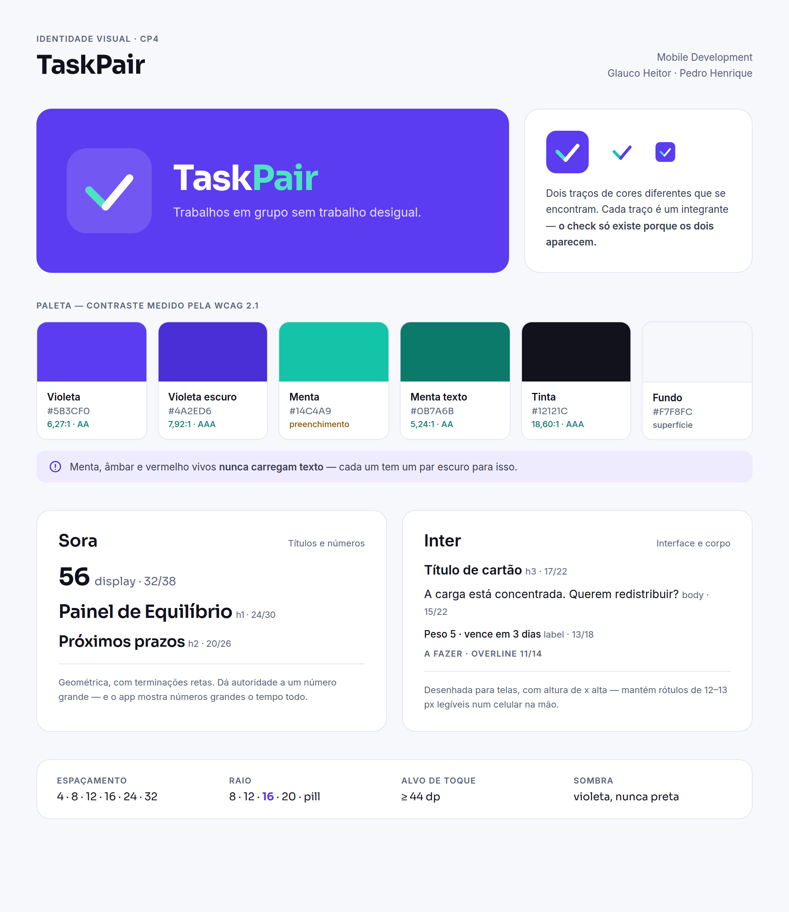
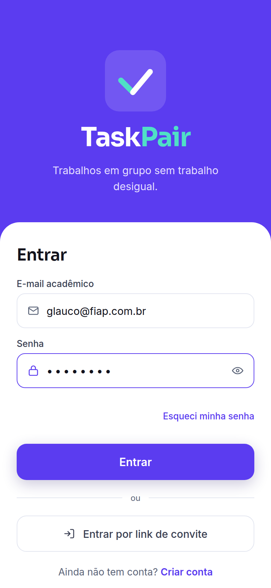
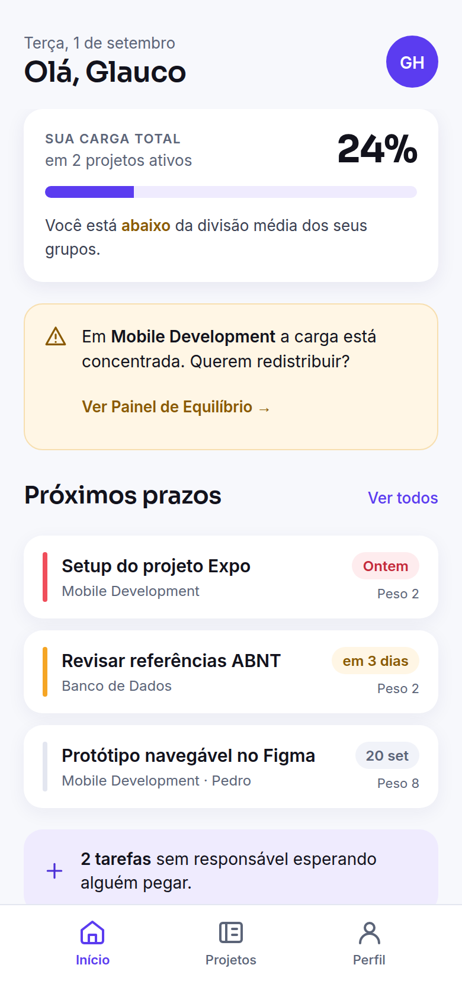
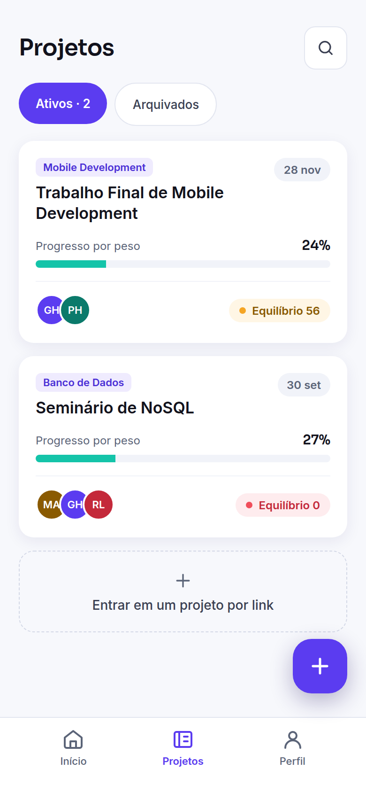
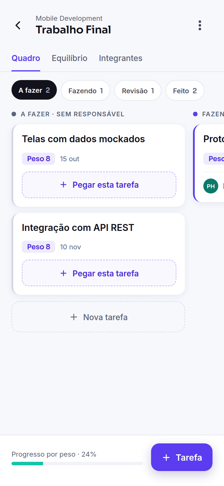
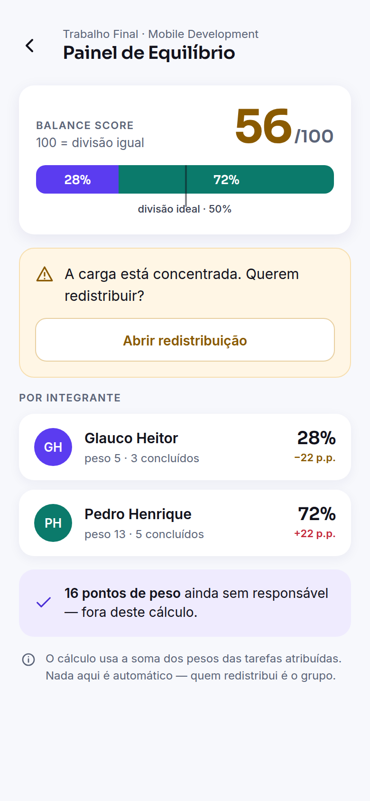
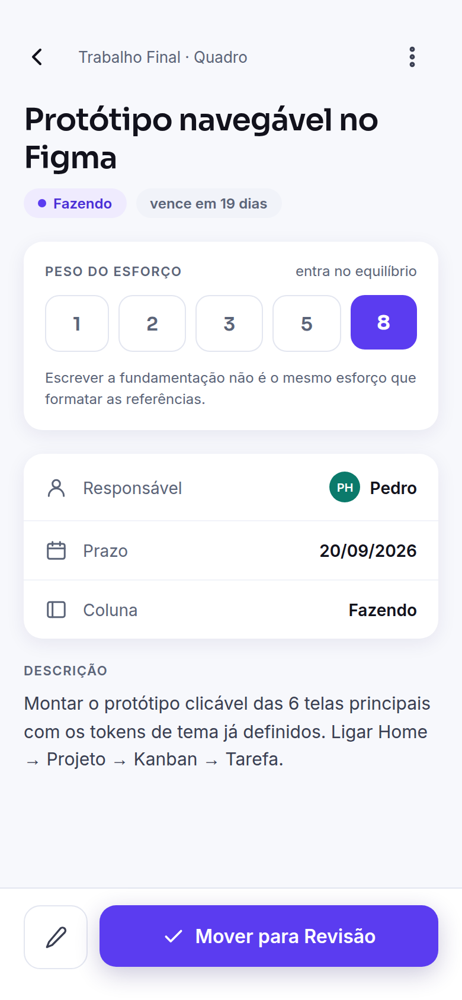

<div align="center">


# TaskPair

**Trabalhos em grupo sem trabalho desigual.**

Aplicativo mobile em React Native que torna visível *quem está fazendo quanto* em um trabalho acadêmico — cedo o bastante para o grupo redistribuir sozinho.


</div>

---

## Integrantes

| Nome | RM | Frente principal |
|---|---|---|
| Glauco Heitor Gonçalves e Silva | 555978 | Arquitetura front-end · API e banco (CP6) |
| Pedro Henrique Junqueira | 556278 | UX/UI e identidade visual · Integração e build |

**Disciplina:** Mobile Development · **Entrega:** Checkpoints 4, 5 e 6

---

## O problema

Todo estudante já carregou um trabalho em grupo sozinho. Existem dezenas de apps de tarefas, e nenhum deles resolve isso — porque todos mostram **o que falta fazer** e nenhum mostra **quem está fazendo quanto**.

Um quadro com 40 cartões, dos quais 31 têm o mesmo rosto no avatar, não avisa ninguém de nada. A informação está lá; ninguém soma. O desequilíbrio só vira assunto na véspera da entrega, quando já não dá para consertar.

## A solução

No TaskPair **toda tarefa tem um peso**. Escrever a fundamentação teórica não é o mesmo esforço que formatar as referências, e um app que conta cartões finge que é.

Com peso, o app responde a pergunta que os outros não respondem — *"quanto do trabalho é meu?"* — em uma barra, na tela inicial, na segunda semana.

### Painel de Equilíbrio

Uma barra empilhada com uma faixa por integrante, proporcional ao peso das tarefas atribuídas, e um **Balance Score** de 0 a 100, onde 100 é divisão perfeitamente igual. Quando alguém passa de 15 pontos percentuais acima da divisão ideal, o app sinaliza — e a frase que aparece é *"a carga está concentrada. Querem redistribuir?"*, nunca *"fulano está fazendo pouco"*.

O cálculo é público e auditável: [`src/utils/workload.ts`](src/utils/workload.ts). Uma métrica que descreve o esforço de pessoas reais precisa poder ser conferida.

> **Transparência, não vigilância.** O app mostra dados que o próprio grupo inseriu. Não rastreia tempo de tela, não monitora atividade, não pontua pessoas, e nenhuma redistribuição é automática — o TaskPair aponta, a conversa é humana.

---

## Documentação

| Documento | Conteúdo |
|---|---|
| 📄 [Escopo](docs/01-escopo.md) | Problema, público-alvo, personas, proposta de valor, requisitos, riscos |
| 🎨 [Marca e identidade visual](docs/02-marca.md) | Nome, símbolo, paleta com contraste verificado, tipografia, tom de voz |
| 💡 [Pitch e modelo de negócio](docs/03-pitch-modelo-de-negocio.md) | Monetização, concorrência, TAM/SAM/SOM, aquisição |
| 🏗️ [Arquitetura](docs/04-arquitetura.md) | Stack, estrutura de pastas, modelo de dados, contrato da API |
| 🗺️ [Roadmap](docs/05-roadmap.md) | O que já está pronto e o que entra no CP5 e no CP6 |

---

## Identidade visual

O símbolo é um check formado por **dois traços de cores diferentes que se encontram**. Cada traço é um integrante do grupo: o check só existe porque os dois aparecem.

| | Violeta | Menta | Tinta |
|---|---|---|---|
| **Hex** | `#5B3CF0` | `#14C4A9` | `#12121C` |
| **Papel** | "eu" — ação individual | "o grupo" — progresso coletivo | Texto |
| **Contraste sobre branco** | 6,27:1 ✅ AA | preenchimento apenas | 18,60:1 ✅ AAA |

**Tipografia:** [Sora](https://fonts.google.com/specimen/Sora) para títulos e números, [Inter](https://fonts.google.com/specimen/Inter) para interface. Ambas open source e empacotadas no APK.

Tokens completos em [`src/theme/`](src/theme). Todos os valores de contraste foram medidos pela fórmula da WCAG 2.1, não estimados a olho.



---

## Telas conceituais

Seis telas do fluxo principal, desenhadas sobre os tokens de `src/theme` — mesmas cores, mesma escala tipográfica, mesmos raios que o app vai usar no CP5.

| Acesso | Home | Projetos |
|:--:|:--:|:--:|
|  |  |  |
| Entrada por e-mail ou por link de convite — o integrante vê o quadro antes de criar conta. | Próximos prazos, carga individual e o alerta de concentração. | Progresso por peso e o Balance Score de cada projeto. |

| Kanban | Painel de Equilíbrio | Detalhe da tarefa |
|:--:|:--:|:--:|
|  |  |  |
| Uma coluna por vez, com a próxima espiando. Tarefas sem responsável trazem "Pegar esta tarefa". | O diferencial: barra empilhada, Balance Score e o convite a redistribuir. | Peso obrigatório na criação — é o que alimenta todo o cálculo. |

Os arquivos em alta resolução estão em [`docs/assets/telas/`](docs/assets/telas) e a especificação completa da marca em [`docs/02-marca.md`](docs/02-marca.md).

---

## Estrutura do projeto

```
taskpair/
├── docs/            Documentação (escopo, marca, pitch, arquitetura, roadmap)
├── brand/           Logo em SVG e PNG
├── .github/         Templates de issue e pull request
└── src/
    ├── theme/       ✅ Tokens de cor, tipografia e espaçamento
    ├── types/       ✅ Modelo de domínio em TypeScript
    ├── utils/       ✅ Cálculo de equilíbrio, prazos, validações
    ├── mocks/       ✅ Dados de exemplo para o CP5
    ├── components/  Common · layout · project · task
    ├── screens/     Auth · home · projects · tasks · profile
    ├── navigation/  Stacks e tabs
    ├── contexts/    AuthContext, ProjectContext
    ├── hooks/       useAuth, useProjects, useTasks, useBalance
    ├── services/    Fronteira única com mocks (CP5) e API REST (CP6)
    └── assets/      Fontes e imagens
```

✅ = implementado neste CP4. O restante são contratos declarados, prontos para o CP5.

A regra que sustenta a estrutura: **nenhuma tela faz `fetch` e nenhuma tela importa de `mocks/`.** Tudo passa por `services/`, e a virada do CP5 para o CP6 é uma linha em [`src/services/api.ts`](src/services/api.ts):

```ts
export const USE_MOCKS = true;   // CP5 — dados mockados
export const USE_MOCKS = false;  // CP6 — API REST
```

---

## Como rodar

> **Estado atual (CP4):** o repositório contém a documentação, a identidade visual e a estrutura do projeto com os tokens, tipos e regras de negócio implementados. As dependências ainda não foram instaladas — isso é a primeira tarefa do CP5.

**Pré-requisitos:** Node.js 18+, npm e o app [Expo Go](https://expo.dev/go) no celular.

```bash
git clone https://github.com/glaucoheitor21/taskpair.git
cd taskpair
npm install
npx expo start
```

Leia o QR Code com o Expo Go (Android) ou com a câmera (iOS).

**Build do APK (CP6):**

```bash
npm install -g eas-cli
eas login
npm run build:apk
```

---

## Stack

| Camada | Tecnologia |
|---|---|
| Runtime | React Native 0.76 · Expo SDK 52 |
| Linguagem | TypeScript (`strict`) |
| Navegação | React Navigation 7 — native-stack + bottom-tabs |
| Estado | Context API + hooks |
| Persistência local | AsyncStorage |
| Fontes | @expo-google-fonts (Sora, Inter) |
| Build | EAS Build → APK |

---

## Roadmap

| Checkpoint | Etapa | Estado |
|---|---|---|
| **CP4** | Idealização — conceito, marca, documentação | ✅ Concluído |
| **CP5** | Protótipo funcional com dados mockados | 🔜 Outubro |
| **CP6** | App final integrado à API + APK instalável | 🔜 Novembro |

Detalhamento em [`docs/05-roadmap.md`](docs/05-roadmap.md).

---

## Convenções

- Commits seguem [Conventional Commits](https://www.conventionalcommits.org/pt-br/): `feat:`, `fix:`, `docs:`, `chore:`, `refactor:`
- `main` protegida; trabalho em branches `feat/<assunto>`, integrado por pull request
- Nenhuma cor, fonte ou espaçamento fora de `src/theme` — isso é item do checklist de PR

---

## Licença

[MIT](LICENSE) © 2026 Glauco Heitor Gonçalves e Silva · Pedro Henrique Junqueira
