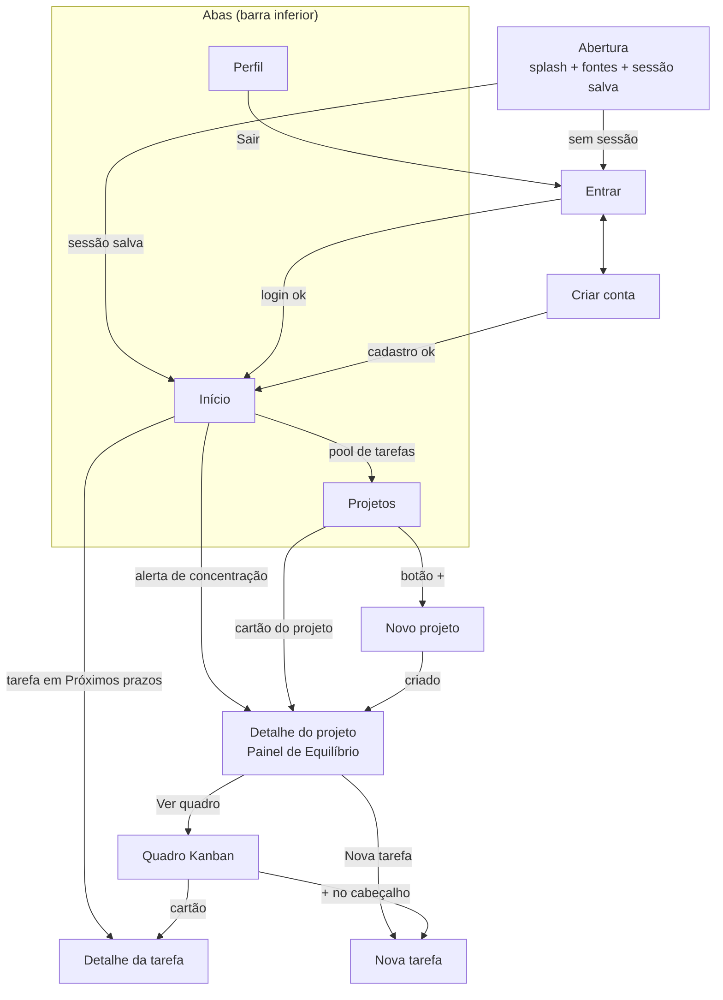
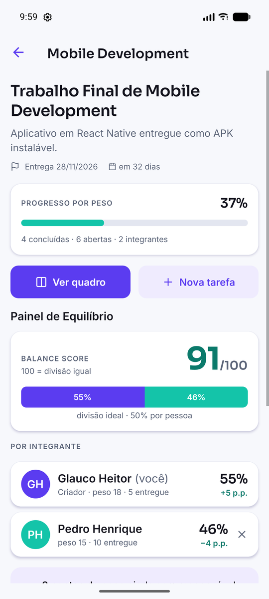

# Telas e fluxos de navegação

Este documento descreve as telas implementadas no app e como o usuário navega entre elas. As capturas estão em [`docs/assets/app/`](assets/app).

---

## 1. Mapa de navegação



**Estrutura técnica** (React Navigation 7):

```
RootNavigator (native-stack)
├── Auth  → AuthNavigator (native-stack)     sem sessão
│           ├── SignIn
│           └── SignUp
└── App   → AppTabs (bottom-tabs)            com sessão
    │       ├── Home
    │       ├── Projects (ProjectList)
    │       └── Profile
    ├── ProjectDetail   { projectId }
    ├── Kanban          { projectId }
    ├── TaskDetail      { taskId }
    ├── NewProject      (modal)
    └── NewTask         { projectId } (modal)
```

> **Mudança em relação ao CP4:** o desenho original colocava as telas de detalhe dentro de uma pilha da aba *Projetos*. Na implementação elas subiram para a pilha raiz, acima das abas. Motivo: a Home também abre tarefas e projetos, e com a pilha dentro da aba o botão *voltar* levava o usuário para a lista de projetos em vez de devolvê-lo à Home. Além disso, a barra de abas some nas telas de detalhe, o que libera espaço para o quadro Kanban.

As rotas são tipadas em [`src/navigation/types.ts`](../src/navigation/types.ts).

---

## 2. Telas

| # | Tela | Arquivo | O que faz |
|---|---|---|---|
| 1 | **Entrar** | `screens/auth/SignInScreen.tsx` | Login por e-mail e senha, com validação. No modo local exibe o atalho "Modo demonstração". |
| 2 | **Criar conta** | `screens/auth/SignUpScreen.tsx` | Nome, e-mail, senha e confirmação. Valida formato de e-mail, tamanho de senha e senhas iguais. |
| 3 | **Início** | `screens/home/HomeScreen.tsx` | Sua carga total (peso atribuído a você ÷ peso distribuído nos seus projetos), alertas de concentração por projeto, próximos prazos e quantas tarefas estão no pool. Puxar para baixo atualiza. |
| 4 | **Projetos** | `screens/projects/ProjectListScreen.tsx` | Cartões com disciplina, progresso por peso, integrantes, tarefas abertas, prazo e Balance Score. Botão flutuante cria projeto. |
| 5 | **Novo projeto** | `screens/projects/NewProjectScreen.tsx` | Nome, disciplina, descrição e data de entrega (com atalhos "+1 semana" etc.). Quem cria vira *owner*. |
| 6 | **Detalhe do projeto** | `screens/projects/ProjectDetailScreen.tsx` | Progresso, **Painel de Equilíbrio** (score, barra empilhada, alerta), carga por integrante com desvio em p.p., peso no pool, convite por e-mail, arquivar e excluir. |
| 7 | **Quadro (Kanban)** | `screens/projects/KanbanScreen.tsx` | Quatro colunas (A fazer, Fazendo, Revisão, Concluído), uma por vez com a próxima espiando. Filtros *Todas / Minhas / Sem responsável*. Cada cartão tem "Pegar esta tarefa" e "→ próxima coluna". |
| 8 | **Nova tarefa** | `screens/tasks/NewTaskScreen.tsx` | Título, descrição, **peso obrigatório** (1·2·3·5·8 com explicação), responsável (ou pool) e prazo. |
| 9 | **Detalhe da tarefa** | `screens/tasks/TaskDetailScreen.tsx` | Edita tudo, inclusive a coluna; "Pegar esta tarefa"; excluir. O botão salvar só habilita quando algo mudou. |
| 10 | **Perfil** | `screens/profile/ProfileScreen.tsx` | Dados da conta, estatísticas (concluídas, abertas, peso entregue), contribuição por projeto vs. divisão ideal, tema (sistema/claro/escuro), fonte de dados ativa, sair. |

### Capturas (APK release no emulador Pixel 7)

| Entrar | Início | Projetos | Detalhe do projeto | Painel com alerta |
|:--:|:--:|:--:|:--:|:--:|
|  |  |  |  |  |

| Quadro | Detalhe da tarefa | Nova tarefa (validação) | Perfil | Modo escuro |
|:--:|:--:|:--:|:--:|:--:|
|  |  |  |  |  |

Estados tratados em todas as listas: **carregando**, **erro com "tentar de novo"** e **vazio** com ação sugerida (ex.: "Gerar projeto de exemplo" na primeira conta do Supabase).

---

## 3. Fluxos principais

### 3.1. Primeiro acesso

1. Abre o app → *Entrar* → **Criar conta**.
2. Após o cadastro cai direto na **Início**, que está vazia e oferece *Criar projeto* ou *Gerar projeto de exemplo*.

### 3.2. Montar o trabalho em grupo

1. **Projetos → +** → preenche nome, disciplina e entrega → *Criar projeto*.
2. No detalhe do projeto, **Convidar integrante** com o e-mail da conta do colega.
3. **Nova tarefa** para cada parte do trabalho, sempre com peso. Pode deixar sem responsável — vai para o pool.

### 3.3. Dia a dia

1. **Início** mostra o que vence primeiro. Tocar abre o detalhe.
2. No **Quadro**, "Pegar esta tarefa" atribui a você; "Fazendo →" avança a coluna.
3. Ao concluir, a data de conclusão é registrada e o progresso do projeto (por peso) sobe.

### 3.4. Redistribuir (o diferencial)

1. Quando alguém passa de **15 p.p.** acima da divisão ideal, aparece o alerta *"A carga está concentrada. Querem redistribuir?"* na Início e no projeto.
2. O Painel mostra a fatia de cada um e quanto peso ainda está no pool.
3. *Abrir redistribuição* leva ao Quadro com o filtro de tarefas; o grupo reatribui no detalhe da tarefa. Nada é automático.
